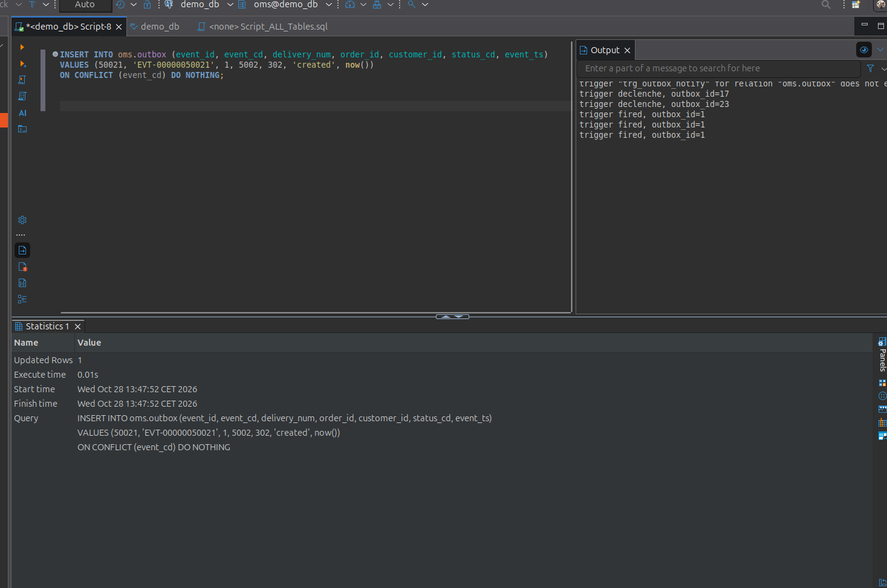
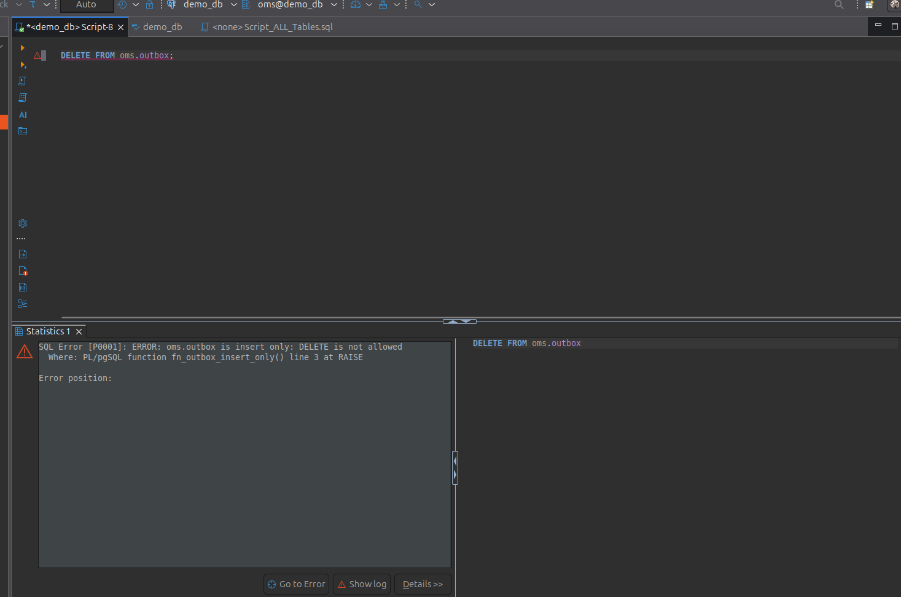
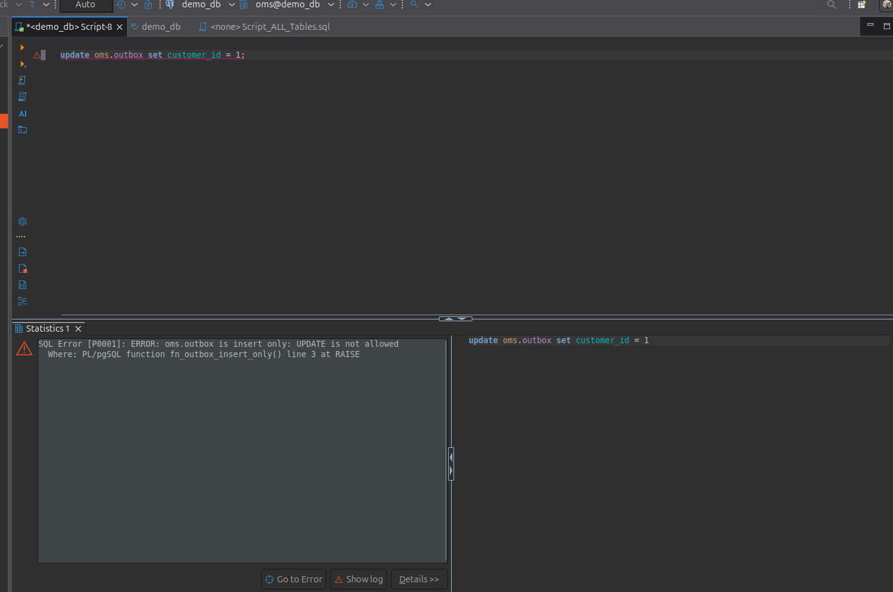

# Unit testing SQL

## Test 01 : watch the listener

```sql
INSERT INTO oms.outbox (event_id, event_cd, delivery_num, order_id, customer_id, status_cd, event_ts)
VALUES (50021, 'EVT-00000050021', 1, 5002, 302, 'created', now())
ON CONFLICT (event_cd,status_cd) DO NOTHING;
```

**Result :**





---

## Test 02 : check delete protection

```sql
DELETE FROM oms.outbox;
```

**Result :**



---
## Test 03 : check truncate protection

```sql
TRUNCATE TABLE oms.outbox;
```

**Result :**


## Test 04 : check update protection

```sql
UPDATE oms.outbox SET customer_id = 1;
```

**Result :**

